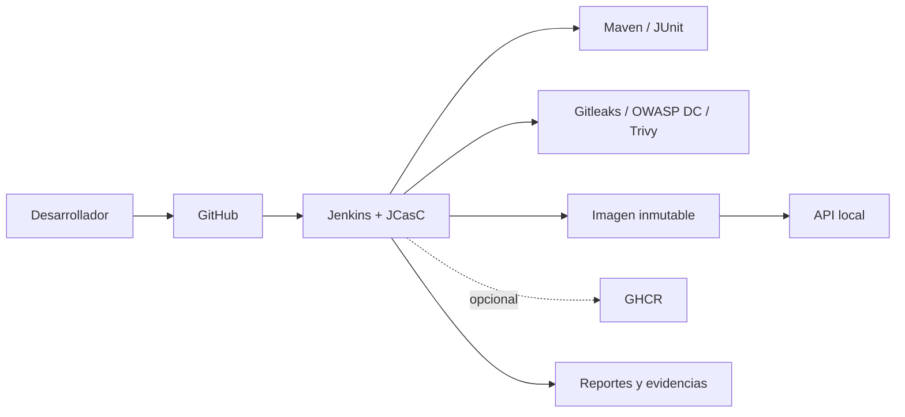

# Jenkins DevSecOps Platform

Portafolio reproducible de CI/CD y DevSecOps ejecutado íntegramente en Docker Desktop. Demuestra cómo llevar una API Java desde el código hasta un despliegue local validado, sin EKS, Kubernetes ni recursos de AWS. El MVP no genera costos de nube.

## Problema y arquitectura

Centraliza compilación, pruebas, análisis de secretos/dependencias/configuración, construcción y escaneo de imagen, despliegue, health check, smoke tests y evidencias. Jenkins LTS se configura con Docker, una lista controlada de plugins, JCasC y Job DSL.



Tecnologías: Jenkins LTS/JDK 17, Docker Compose, Spring Boot 3, Maven, JUnit 5, Gitleaks, Trivy, OWASP Dependency-Check, PowerShell y Mermaid. SonarQube Community queda como perfil opcional de segunda fase.

## Requisitos

- Windows 10/11, PowerShell 7 recomendado y Git.
- Docker Desktop con WSL2 y al menos 6 GB de memoria para una ejecución cómoda.
- Puertos 8080 (API), 8081/50000 (Jenkins) y, opcionalmente, 9000 (SonarQube).
- Maven local es opcional: Docker lo proporciona durante build y pipeline.

## Estructura

`app/` contiene la API; `jenkins/` la imagen, plugins y JCasC; `scripts/` la operación en Windows; `docs/` el diseño y runbooks; `reports/` las evidencias generadas; `Jenkinsfile` expresa el flujo completo.

## Inicio rápido

En **PowerShell local**, desde la raíz del repositorio:

```powershell
Copy-Item .env.example .env
# Edite .env y reemplace CHANGE_ME por una contraseña local larga.
./scripts/validate.ps1
./scripts/start.ps1
./scripts/status.ps1
```

Abra `http://localhost:8081`, inicie sesión con los valores locales de `.env` y ejecute `jenkins-devsecops-platform`. El job usa la rama `main` de `GIT_REPOSITORY_URL`; publique el contenido en el repositorio únicamente cuando usted lo autorice. Hasta entonces puede validar la aplicación con Compose:

```powershell
docker compose --profile app up -d --build app
Invoke-RestMethod http://localhost:8080/actuator/health
Invoke-RestMethod http://localhost:8080/api/health
Invoke-RestMethod http://localhost:8080/api/info
Invoke-RestMethod http://localhost:8080/api/version
```

En **interfaz web de Jenkins**, verifique `Manage Jenkins > System` y el mensaje “managed with JCasC”. En `Manage Jenkins > Plugins > Installed`, confirme Configuration as Code, Pipeline, Git, JUnit y HTML Publisher.

## Pipeline y credenciales

Parámetros: `RUN_SECURITY_SCAN`, `DEPLOY_LOCAL`, `PUBLISH_IMAGE` y `IMAGE_TAG`. El tag predeterminado es `<BUILD_NUMBER>-<commit SHA corto>`; `latest` no se usa. Para GHCR, en **interfaz web de Jenkins** cree una credencial Username with password con ID `ghcr-credentials`: usuario GitHub y token en el campo password. Permiso mínimo: `write:packages` (y `read:packages` si necesita descargar). No active `PUBLISH_IMAGE` sin autorización.

El controlador Jenkins monta el socket Docker y se ejecuta como root para operarlo. Esto equivale a acceso privilegiado al host Docker y se acepta solo para el laboratorio local; consulte [security.md](docs/security.md).

## Seguridad y evidencias

Los reportes se guardan bajo `reports/` y Jenkins los archiva. Gitleaks bloquea hallazgos; Trivy registra `HIGH` como advertencia y bloquea vulnerabilidades `CRITICAL` no corregidas; Dependency-Check bloquea CVSS 9+. No se ocultan resultados. `.env`, llaves, almacenes y artefactos se ignoran.

## Operación y solución de problemas

En **PowerShell local**, desde la raíz:

```powershell
./scripts/logs.ps1 -Service jenkins
./scripts/stop.ps1
./scripts/clean.ps1                 # conserva volúmenes
./scripts/clean.ps1 -Volumes        # solicita confirmación y borra datos persistentes
```

Consulte [installation.md](docs/installation.md), [pipeline.md](docs/pipeline.md), [security.md](docs/security.md) y [troubleshooting.md](docs/troubleshooting.md).

## Mejoras futuras

Agente Jenkins aislado, rootless Docker/BuildKit, firma Cosign, SBOM, SonarQube, observabilidad OpenTelemetry, rollback automatizado, Terraform para entornos gratuitos y GitHub webhooks. Kubernetes/EKS queda explícitamente fuera del MVP.

## Costos y licencia

El MVP utiliza herramientas gratuitas/open source y recursos locales; no provisiona AWS. GHCR puede estar sujeto a cuotas de la cuenta. Código bajo licencia MIT.

