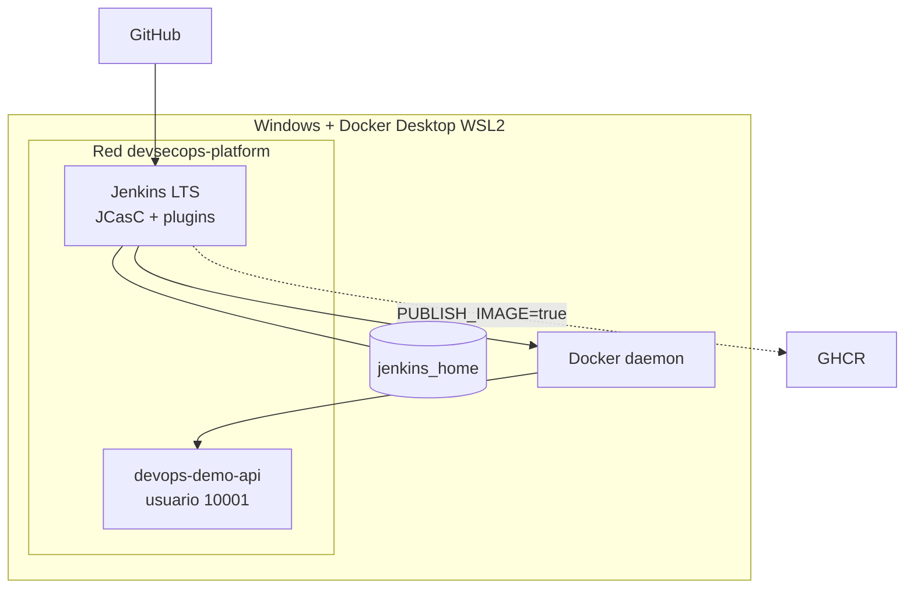

# Arquitectura

Jenkins es el orquestador y Docker Desktop el runtime. El controlador conserva su configuración en `devsecops-jenkins-home`, carga JCasC desde un montaje de solo lectura y accede al daemon mediante el socket. La API y Jenkins comparten la red `devsecops-platform`.

El montaje del socket concede control elevado sobre Docker; es una decisión local documentada en ADR-001, no un patrón recomendado para producción.

