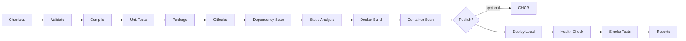
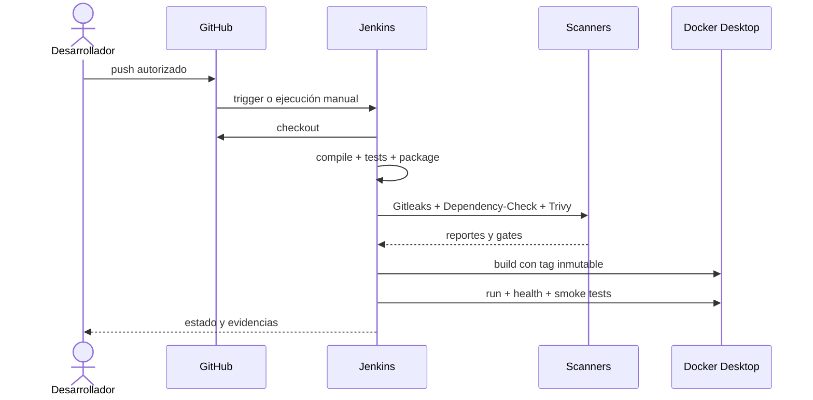

# Pipeline

Cada comando termina con código distinto de cero ante un fallo bloqueante y Jenkins muestra el stage. JUnit publica XML aunque fallen las pruebas. `post.always` archiva evidencia, elimina el contenedor temporal y limpia el workspace.

